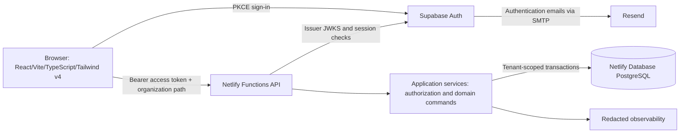

# Architecture overview

## System and trust boundaries

Browser input, organization identifiers, IDs, timing claims and JWT authorization claims are untrusted. Supabase authenticates identities only. Functions verify tokens and resolve current database authorization. No browser connection to application PostgreSQL; no Supabase application tables. Netlify dashboard access is infrastructure privilege and is not a Hourvia Platform Super Admin role.

Use a modular monolith to preserve transactional integrity and simplify tenant isolation and operations. Shared libraries contain validation contracts, IDs and error vocabulary; frontend bundles never import server configuration or database clients. Keep API modules framework-independent behind thin Functions handlers. Avoid queues, microservices and cross-service transactions until measured load requires them.

## Request path

Verify request size, origin policy, method and content type; authenticate; establish current application session; load tenant membership; authorize action and resource scope; validate typed input; open scoped database transaction; recheck revocation-sensitive membership under lock; run command; persist state, idempotency receipt, audit and outbox atomically; return sanitized response with request ID. Deny by default. Global endpoints are restricted separately and cannot silently select an organization.

## API design

Use /api/v1/orgs/{organizationId}/... with resource UUIDs. Examples: POST /tracking/commands, GET /dtr, POST /timesheets/{id}/submit, POST /corrections/{id}/approve, POST /invoices/prepare. Explicit command names avoid arbitrary status patches. GET is side-effect free. Heartbeats use POST. OpenAPI contracts and runtime schemas are the source for request/response tests; strict TypeScript alone does not validate runtime data.

Reject unknown command fields, invalid IANA zones, overlong descriptions, invalid date ranges and mismatched organization IDs. Parameterize SQL; allowlist sort columns and filters. Use keyset pagination, stable ordering, capped page size (proposed 100), and bounded report ranges. Cross-tenant or inaccessible resource IDs return 404; valid identity without action permission returns 403. Use 401 for invalid/revoked sessions, 409 for state/revision conflicts, 422 for domain validation, 429 with Retry-After for limits, 503 for dependency failure. Return {error:{code,message,requestId,fieldErrors?}}; never return SQL, tokens or stack traces.

Commands carry Idempotency-Key and expectedVersion; persist request hash and exact outcome under a tenant/actor/route/key uniqueness constraint. Same key with different payload is 409. Retry transient deadlocks/serialization failures with bounded jitter; never repeat an external side effect without its outbox key. Set concrete retention for receipts before launch (proposed seven days; financial command identifiers remain permanent).

## Performance and resilience

Index tenant-leading access paths; avoid N+1 reads. Measure p95 targets initially: ordinary API reads <500 ms and tracking commands <750 ms, excluding sign-in and cold-start separately. These are targets, not results. Load-test the heartbeat fanout, pool limits and cold starts at 3x forecast concurrency; set budgets after ThriveSource seat count is confirmed. Use bounded pools and same-client transactions; test @netlify/database driver semantics rather than assuming HTTP queries share a transaction. Drizzle adapter currently requires beta releases; pin resolved versions and lockfile after compatibility testing.

Calculate totals from versioned projections, not repeated full event scans on dashboards. Use resumable, capped batches for large exports and outbox delivery. Partition/archive only after measuring size and query plans. Rate-limit using a shared platform-backed control or PostgreSQL counters, never per-Function memory as authoritative state.

## PWA

Allow installable shell and static asset caching later in MVP hardening. Never cache authenticated API responses, tokens, DTR or CSV files in the service worker. No offline clock events or background sync; a cached shell displays disconnected status and cannot submit historical activity. Clear private UI state on logout or organization switch. Deploy/service-worker updates cannot restart tracking; foreground revalidation and explicit user action are required after a lost connection.
