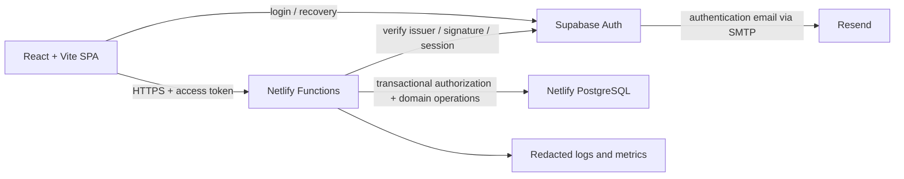

# Architecture and bounded modules

## Runtime and trust boundaries

Supabase is the identity authority. Netlify Database is the organization, permission, session-denial and business-record authority. Supabase's database, if present in the reused project, is not Hourvia application storage. Resend delivers authentication messages through Supabase SMTP; application invitation delivery can use a separately scoped server integration later. The user-facing origin is HTTPS only with a canonical hostname.

Choose a modular monolith, one deployment unit and one relational database. Keep entrypoints thin and domain modules testable without HTTP. Proposed layout: `src/` UI; `netlify/functions/` adapters; `server/modules/` services and repositories; `server/security/` token verification and authorization; `server/platform/` database, mail, logging; `shared/contracts/` runtime validation and public types; `db/schema.ts` canonical Drizzle schema after implementation approval. These paths are proposals, not files created in Sprint 0.

| Module | Owns | Allowed dependency |
| --- | --- | --- |
| Identity bridge | Subject mapping, application sessions, revocation, callback validation | Supabase, shared security infrastructure |
| Organizations | Memberships, invitations, roles, manager scopes | Identity bridge |
| Entitlements | Internal grants, plan versions, future subscriptions, seat admission | Organizations |
| Clients/projects | Client records, projects, assignments, dated rates | Organizations |
| Tracking | Shifts, heartbeat accounting, work/pause intervals, events | Organizations, assignments |
| Timesheets | DTR projections, cutoffs, submission revisions, correction review | Tracking, organization scopes |
| Billing | Approved billable allocations, invoice drafts and reports | Approved timesheet revisions, dated rates |
| Monitoring policy | Policy versions, delegation, acknowledgement/consent | Organizations |
| Audit/outbox | Append-only events and reliable side-effect delivery | Infrastructure only |

Modules call exposed services, not another module's repository. Audit writes share the caller's transaction. Billing reads approved timesheet contracts; it cannot edit tracking. Avoid circular dependencies by passing identifiers and emitting versioned outbox events. No microservices, payment processor or desktop agent in MVP.

## API and operational conventions

Use `/api/v1/orgs/{orgId}/...` and a separate `/api/v1/platform/...` boundary. Derive actor from a verified token; never accept actor, permission, rate, entitlement or organization ownership from an unchecked body. Every org route loads active membership and scoped permission for that org. Object lookup includes org ID; inaccessible and absent objects both return 404. Schema validation rejects unknown fields, invalid UUIDs, oversized text, invalid IANA zones and timestamps outside permitted correction workflows. Use parameterized SQL and allowlisted sort fields.

Commands use POST with idempotency keys; resource edits require a version/If-Match. Example contracts: `POST tracking/commands` with command, expectedVersion, assignmentId and description; `POST tracking/heartbeats` with session and sequence; `POST timesheets/{id}/submit`; `POST correction-requests/{id}/approve`; `GET dtr?from=...&to=...`; `POST invoices/prepare`. Server returns effective timestamps and state version. Cursor pagination and bounded date ranges are mandatory.

Return a stable problem document with code, status, safe detail and request ID. Use 400 validation, 401 identity, 403 known membership permission denial, 404 inaccessible resource, 409 state/idempotency/version conflict, 429 throttling, and generic 500. Never return SQL errors, tokens, invitation links or infrastructure internals. Retry transient serialization/deadlock errors with bounded jitter; do not retry non-idempotent external side effects blindly. Apply request limits and distributed, persistent rate limits, especially login-adjacent and invitation routes.

## Identity and sessions

Initial onboarding is invitation-only. Disable public signup only after an authorized audit and configuration review. No domain-name auto-enrollment. A verified Supabase account without an accepted application invitation has no organization access. Users can hold several memberships, and a solo consultant is represented by a one-member organization. Self-service organization creation remains disabled until commercial onboarding is approved.

Every function verifies JWT signature using the exact environment's issuer and JWKS, explicitly allowed signing algorithm, expiry, audience and subject; reject tokens from other projects. Cache keys for a bounded period, refresh on unknown key ID with rate limiting, and fail closed on unverifiable keys. Confirm the reused project's signing configuration before choosing the verifier; do not assume asymmetric keys. Do not copy a legacy symmetric signing secret. Map `(issuer, sub)` to a local user ID, not email. Require a valid session identifier for application session registration and evaluate local revocation on each request.

For MVP, the SPA uses Supabase PKCE with refresh credentials held in memory rather than persistent browser storage. Reload can require authentication again; evaluate that UX before release. XSS can still steal an in-memory token: enforce CSP, no untrusted HTML, dependency review and short access-token lifetime. A later same-origin BFF with secure HttpOnly cookies requires a separate CSRF and refresh-token ADR. Authorization headers carry access tokens; logs redact them. No service-role key in browser builds. Browser-visible project URL and publishable key are configuration, not privileged credentials.

Application sessions are registered after identity verification and tied to the verified Supabase session ID. Middleware checks user disabled state, session denial, membership status, permission version and resource scope, including within mutation transactions. Explicit logout denies that local session immediately and asks Supabase to revoke refresh access. Membership suspension/removal denies that organization immediately even if JWT remains valid. Security-driven global revocation denies all local sessions and requests Supabase global refresh revocation; provider outages do not weaken local denial. JWT expiry alone is insufficient immediate revocation. Rotate/expire session registrations with reauthentication; no automatic re-registration of a denied session. Step-up recent MFA is required for platform access and destructive/high-privilege org actions, with factor and recovery behavior verified in the identity audit.

Invitation workflow: an authorized inviter selects email, role and scope; server checks seat admission and creates an expiring, single-use opaque token, stores only a digest, and sends through an approved mail path. Supabase invite/recovery tokens and application invitation tokens have different purposes. On acceptance, authenticate with PKCE, require verified matching normalized email and the intended issuer, lock invite and organization admission rows, validate digest/expiry/revocation and consume once in the same transaction as activating membership. Never auto-link accounts by unverified email. Role changes after sending require revoking and issuing a new invitation. Do not hold a database transaction open during email delivery; use an outbox. Redact callbacks from logs and apply a restrictive referrer policy.

Recovery uses generic responses to avoid account enumeration, rate limits, verified provider flows and exact environment redirect targets. Recovery never creates membership or changes roles. Recheck sensitive actions after recovery; revoke other sessions according to a tested policy. Reject open `next` URLs, wildcard redirects, external URL schemes and arbitrary preview origins. Invite and recovery pages exchange tokens, clear URL material promptly and prevent analytics collection there.

Before reusing the existing Supabase project, inventory users and applications without exporting V1 data; verify ownership, tenant/project purpose, signing keys, MFA, compromised-account handling, signup and provider settings, redirect entries, session durations, email templates and SMTP sender/domain alignment. Determine whether existing identities are authorized for reuse without inheriting application access. A shared V1 production identity project may not permit safe signup/redirect/SMTP changes; if isolation cannot be proven, propose a dedicated V2 project for approval. Dev/test must use a separate identity project and test mail, never production users or recovery links. No audit or change was performed in Sprint 0.

## Roles and membership lifecycle

| Capability | Platform Super Admin | Owner | Administrator | Authorized Manager | Contractor/Member |
| --- | --- | --- | --- | --- | --- |
| Platform organization lifecycle/internal grant | Yes, step-up and audited | No | No | No | No |
| Transfer ownership/delete org | No implicit org access | Yes, step-up | No | No | No |
| Membership management | Break-glass only | Yes | Members/managers, no ownership escalation | No | No |
| Clients/projects/assignments/rates | No implicit org access | Yes | Yes | Explicit project/billing scopes only | Assigned project read only |
| Track and see own DTR | Requires membership | Yes | Yes | Yes | Yes |
| Review other people's time/corrections | No implicit org access | Yes | Yes | Assigned team/project review scope | No |
| Billing and exports of others | No implicit org access | Yes | Yes | Explicit billing/export scope | Own CSV only |
| Monitoring policy | No covert override | Yes | Yes | Explicit monitoring-policy delegation | No |
| Subscription management, later | Platform support scope | Yes | Explicit delegation later | No | No |

Platform roles live separately from memberships; being a super admin does not bypass tenant checks. Break-glass access needs a time-limited explicit grant, reason, MFA and immutable access record; implement only when support operations are approved. Role changes cannot grant capabilities the actor cannot delegate. Managers are bounded by explicit team/project assignments and capability grants; they cannot approve their own submissions or corrections. Owners/admins also cannot self-approve; a single-member org may track and export personal records but approval/billing waits for a separately authorized reviewer. No implicit self-review exception.

Membership lifecycle: pending invitation → active → suspended or removed; expired/revoked invitation never becomes membership. Reinstatement is an explicit audited action. Enforce at least one active owner and explicit accepted ownership transfer before last-owner removal. Suspension closes any active tracking at last acknowledged contact and revokes org access atomically. Removal preserves referenced financial/time history; it is not a cascade delete. Leaving an org uses the same last-owner and active-session rules. Demotion invalidates permission caches immediately; recheck permissions inside write transactions. Historical names may be pseudonymized under a retention policy without deleting evidence.

## Server-authoritative time tracking

Public states: Clocked Out, Working, On Break, At Lunch. Internally maintain a shift, versioned tracker row and a separately tracked connectivity lease. A shift captures one org and subject. Proposed rule: one open shift per user globally, including across organizations, to avoid concurrent billing; disclose this rule without revealing another organization's details. Changing organization requires Clock Out. Project changes while working close the segment and open a new segment atomically. Every new work segment requires an active assignment and a nonblank description (maximum 2,000 characters).

| Current state | Command | Next state / effect |
| --- | --- | --- |
| Clocked Out | Clock In | Working; open shift and work segment after assignment/description validation |
| Working | Break / Lunch | On Break / At Lunch; close work at authoritative command time |
| On Break / At Lunch | Resume | Working; validate assignment/description, explicitly open new segment |
| Working / pause state | Clock Out | Clocked Out; close segment and shift |
| Working | Change Project | Working; new validated work segment, no overlap |
| Any state | Invalid command | 409; no partial changes |
| Working / pause state | Lease expires | Clocked Out with disconnect reason; effective closure at last acknowledged contact |
| Clocked Out after disconnect | Explicit Resume | Working in a new linked shift; requires current project and description |

Explicit Resume never happens because a tab reconnects, reloads or obtains a refreshed token. Resume on a normal Clocked Out record without a disconnect marker is invalid; use Clock In. Break→Lunch requires Resume then Lunch; no silent pause switching. Clock In/Resume and authenticated periodic heartbeats record server receipt times; suggested heartbeat 15 seconds, lease timeout 45 seconds, subject to pilot validation. Client clocks never determine credited time. Heartbeats bind session, tracker version and increasing sequence; old/replayed/late heartbeats cannot reopen a closed lease.

Accounting rule: completed acknowledged work intervals count; the live UI shows provisional time separately. If the lease expires, credit stops at the last server-acknowledged heartbeat, not at the expiry deadline. An authenticated explicit Clock Out or pause before expiry can close at server receipt time. Requests arriving at/after expiry first finalize the expired lease and cannot bridge the gap. A scheduled sweeper finalizes abandoned rows, while every command, heartbeat and report also evaluates expiry so scheduler delay never inflates totals. Pause time is always excluded. UI connectivity events can stop tracking earlier for convenience but are not trusted evidence.

A browser cannot prove uninterrupted connectivity between heartbeats or distinguish sleep, packet loss and a disabled tab. This is a disclosed bounded-observation approximation; no browser-only design can guarantee exclusion of every millisecond of disconnection. A stricter interpretation is a product blocker requiring an approved accounting policy, not a solved technical guarantee. Do not advertise presence as productivity or run monitoring covertly. Background throttling can cause conservative lost time; show the last acknowledged timestamp and use reviewed corrections for legitimate work.

Store all instants as PostgreSQL `timestamptz`; display in the selected IANA timezone. Each cutoff snapshots the organization's reporting timezone. Split intervals at local midnight and cutoff boundaries using timezone rules, not fixed 24-hour arithmetic. Overnight shifts span days; elapsed time uses UTC, including DST folds/gaps. Half-open `[start,end)` intervals prevent double counts. Sum integer seconds excluding pauses; round only at explicit report/invoice presentation rules, not per heartbeat.

## DTR, timesheets and billing

DTR is a projection of raw segments plus approved correction adjustments, showing gross span, breaks, lunch, net work, project, disconnects and correction provenance. Never overwrite raw tracker events. Cutoffs are local days 1–15 and 16–month-end, with inclusive UI dates represented by half-open UTC boundaries. Timezone changes take effect next cutoff; never rewrite an approved period.

Timesheet lifecycle: draft → submitted immutable revision → approved or rejected; rejection requires a reason, edits create a new revision. Submission requires no unresolved open shift in the period and identifies outstanding correction requests. Reviewer locks revision, checks scope and separation of duties, and records decision. Approved totals reference exact segment/adjustment IDs and calculation version. Later corrections never mutate an approved snapshot.

Correction workflow: member requests original reference, proposed intervals/project/description and reason; validate overlap, assignment and bounds. Pending/rejected corrections have no effect on approved totals. Reviewer cannot be requester/beneficiary. Approval atomically appends immutable adjustment and review event. For an already approved period, reopen through a new revision and obtain approval before the revised totals become billable. A prior approval is superseded, not erased. After invoicing, an adjustment requires a credit/debit linkage in a later draft; never silently rewrite issued reports. Manager direct edits use the same reason/review process.

Clients own projects in one organization. Effective-dated rates are client billing rates, not wages. Rate precedence: assignment override, then project rate; each rate includes currency, effective interval and scope. No fallback guess when absent or overlapping: block preparation and report the unresolved rate. Split approved billable seconds at rate boundaries, retain rate/currency/calculation snapshots, and use decimal arithmetic with a documented minor-unit rounding rule. Never combine currencies in a total. MVP can use project-only rates initially while retaining assignment override schema.

Invoice preparation consumes only approved timesheet revision allocations marked billable. Unique allocation claims prevent duplicate billing under concurrent requests. Draft → prepared/issued-record → voided, with immutable issued snapshots and explicit adjustments; initial release delivers drafts/reports and CSV only, not payment collection, tax automation or legal e-invoicing. A finalization command must recheck current approval revision and unbilled allocations. Approved time must not be billed twice when superseded: preserve prior claims and invoice only explicit deltas. No employee payroll, statutory deductions or disbursements.

CSV exports enforce the same tenant/scope permissions as screens, bound date ranges, record requester and provenance, and neutralize spreadsheet formula cells beginning with `=`, `+`, `-`, `@` or control whitespace. Download responses are private/no-store. Large exports later use scoped expiring artifacts and audited downloads; do not expose public storage URLs.

## Monitoring, PWA and nonfunctional design

Monitoring is OFF by default. Owner/admin or an explicitly delegated manager can version policy; members cannot configure it. Policy changes need visible notice, purpose, retention, acknowledgement and consent where applicable, with jurisdiction/legal review before activation. OS permissions are separate from policy consent and are not bypassed. MVP includes the OFF state and transparent policy display only; desktop screenshots, activity capture, keystrokes, app/URL collection and installation are deferred.

PWA MVP is an optional installable shell. Cache only versioned public static assets. Never cache tokens, API/DTR/billing responses or invitation/recovery pages, and never queue time commands or use background sync to replay them. Offline UI disables commands and explains excluded intervals; reconnect requires explicit action. Service worker updates must not erase or reopen server tracking; logout clears any private client state.

Use structured logs with request/trace ID, opaque actor/org ID, command type, outcome, latency and release ID; redact tokens, descriptions and personal email. Separate immutable business audit from short-lived debug logs. Track auth failures, cross-tenant denials, heartbeat latency/expiry, command conflicts, approval errors, outbox age, function errors, DB connection use and export load. Alert on elevated 5xx, stale tracking sweeper and failed outbox processing; rate-limit expected-denial alerts to avoid noise. Audit all support access.

Set provisional targets for pilot: p95 tracking command <750 ms and DTR query <2 s at 100 concurrent trackers, excluding first-load network effects. Heartbeats at 15 seconds imply about 6.7 requests/second for 100 workers; test cost and database write amplification before scale. Use bounded connection pools per function instance, short transactions, tenant-first indexes and keyset pagination. Partition/archive large append-only events only after measurements. Defer reporting replicas and queues until justified. Scheduled processing must be idempotent; outbox with retry/dead-letter records provides reliable effects without distributed transactions. Proposed event retention and SLOs require organizational approval.
